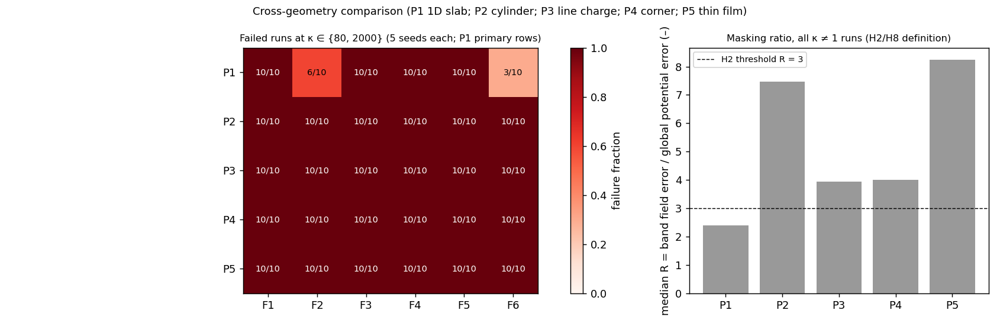

# When Do Physics-Informed Neural Networks Resolve Dielectric Interfaces?

**A pre-registered, seed-level evaluation of PINNs against interface-conforming finite elements**

Devesh Patwari · Daksh Mehta · Tolga Uras Kurtay · Yasir Balat
*Independent high-school researchers* · Contact: devesh.patwari.1@gmail.com

[Paper (Markdown)](manuscript/final/PINN_dielectric_interfaces_paper.md) ·
[Paper (PDF)](manuscript/final/PINN_dielectric_interfaces_paper.pdf) ·
[Plain-language explainer (PDF)](educational_resource/PINN_project_explained_simply.pdf) ·
[Reproduction guide](docs/REPRODUCTION_GUIDE.md) ·
[Documentation index](docs/README.md)

---

## Overview

Physics-informed neural networks (PINNs) are increasingly used for electrostatic problems with materials of different permittivity, yet their accuracy is usually reported as a global error from the best of several runs. The quantity engineers need, the electric field *at the material interface*, where insulation breaks down, is rarely measured.

This project evaluates six PINN formulations on five dielectric-interface problems, from a one-dimensional layered capacitor to a thin high-permittivity film, over permittivity contrasts from 1 to 2000. Every configuration is trained with five matched random seeds under a fixed budget, the interface-band field error is measured against exact or converged reference solutions, and every hypothesis, metric and threshold was written down before the experiments were run.

## Key findings

| | Result |
|---|---|
| **1D capacitor** | A single network with a strong-form loss fails at every contrast κ ≥ 5 (its loss cannot see the flux condition); two-network formulations survive to κ = 400–2000. |
| **2D geometries** | At κ ≥ 80, **every** formulation fails **every** seed on the cylinder, line charge, corner and thin film. |
| **Hidden failures** | Global potential error understates the interface field error by a median factor of 2.4–8.2; on the thin film, 37% of failures look accurate by the usual metric. |
| **Attempted fixes** | Gradient rebalancing, residual normalisation and hard continuity do not remove high-contrast failures; float64 has no effect under Adam once the initialisation is held fixed; L-BFGS helps in 1D but not on the curved interface. |
| **Robustness** | The formulation ranking is unchanged by eight variations of width, depth, sampling, learning rate and training length (Kendall τ ≥ 0.65). |
| **Versus FEM** | Interface-conforming quadratic FEM reaches 1% interface field error in 0.10–4.75 s; no PINN configuration reaches 1% at any κ ≠ 1. |



## Repository structure

```
├── src/                     Library code
│   ├── problems/            P1–P5 definitions: geometry, data, exact / reference solutions, quadrature
│   ├── pinns/               PINN formulations F1–F6 (1D and 2D), networks, training loops, diagnostics
│   ├── fem/                 Finite element reference solvers (1D, and 2D with gmsh + scikit-fem)
│   ├── evaluator/           Metric computation and evaluator self-tests
│   ├── experiments/         Run identifiers, database writer, provenance (git, software, hardware)
│   └── analysis/            Analyses that turn raw results into tables and figures
├── scripts/                 Command-line entry points (sweeps, self-tests, references, make_all)
├── configs/                 Frozen experimental settings (protocol and per-problem YAML)
├── tests/                   Automated tests (169)
├── results/
│   ├── raw/                 Run databases, per-run training trajectories and gradient logs
│   ├── processed/           Tables and verdicts produced by the analysis pipeline
│   ├── figures/             All figures
│   ├── validation/          Evaluator self-test reports
│   └── reference/           Stored FEM reference solutions (P5)
├── docs/                    Protocol, change log, schema, reproduction guide, phase reports
├── manuscript/              Paper (final/ = formatted Markdown, PDF and Word versions)
├── literature/              Literature database, review, research-gap matrix, bibliography
└── educational_resource/    Tutorial and plain-language explainer
```

## Quick start

```sh
git clone https://github.com/upcomingresearcher-cloud/PINNs-dielectric-.git
cd PINNs-dielectric-
sh scripts/setup_environment.sh          # pinned dependencies (Python 3.12, CPU)
python scripts/make_all.py               # regenerate every table and figure from results/raw (~70 s)
python -m pytest tests -q                # 169 tests (~9 min on one core)
```

To rerun experiments, see the [reproduction guide](docs/REPRODUCTION_GUIDE.md). Every number in the paper is produced by `scripts/make_all.py` from the raw databases; nothing is edited by hand.

## Study design

- **Problems:** P1 layered capacitor (1D), P2 dielectric cylinder, P3 line charge above a planar interface, P4 two-material corner, P5 thin film.
- **Formulations:** F1 single network; F2 two networks with soft continuity and flux; F3 interface-distance input; F4 hard continuity; F5 energy (Ritz) formulation; F6 F2 with physics-scaled weights.
- **Metric:** relative L² error of E and D within 0.05 of the interface; a run fails above 5%.
- **Statistics:** five matched seeds per configuration (ten for interventions), medians, exact binomial intervals, paired sign tests; no best-seed selection.
- **Pre-registration:** eleven hypotheses with support and refutation criteria were fixed in [`docs/experimental_protocol.md`](docs/experimental_protocol.md) before the experiments; every later decision is dated in [`docs/protocol_change_log.md`](docs/protocol_change_log.md).

The project ran in 14 phases, each documented in [`docs/phases/`](docs/phases/).

## Data

| File | Contents |
|---|---|
| `results/raw/runs.csv` | 1D training runs, one row per run (configuration, all metrics, cost, provenance) |
| `results/raw/runs_2d.csv` | 2D training runs |
| `results/raw/fem_runs*.csv` | FEM refinement records |
| `results/raw/trajectories/` | Metrics every 250 steps for each run |
| `results/raw/gradlogs/` | Per-term loss values and gradient norms every 25 steps for each run |

The column definitions are in [`docs/database_schema.md`](docs/database_schema.md). Rows superseded after a bug fix and rows from technical failures are kept and labelled; the analysis excludes them.

## Citation

If you use this work, please cite it as described in [`CITATION.cff`](CITATION.cff).

## Use of AI tools

The authors conceived and directed this study, reviewed all results and take responsibility for the content. The AI system Claude (Anthropic) was used extensively under the authors' direction for code, experiments, analysis and drafting; see the disclosure in the paper.

## License

Released under the [MIT License](LICENSE).

## Acknowledgments

We thank John DeMason (University of Michigan, Ann Arbor) for his support.
