# When Do Physics-Informed Neural Networks Resolve Dielectric Interfaces? A Pre-registered, Seed-Level Evaluation Against Interface-Conforming Finite Elements

October 2026
Devesh Patwari¹, Daksh Mehta¹, Tolga Uras Kurtay¹, Yasir Balat¹

¹ Independent high-school researchers

Corresponding author: Devesh Patwari, devesh.patwari.1@gmail.com

**Keywords:** physics-informed neural networks; dielectric interfaces;
electrostatics; high-contrast coefficients; finite element method;
pre-registration; reproducibility

## Abstract

**Background.** Physics-informed neural networks (PINNs) are
increasingly applied to electrostatic problems with piecewise-constant
permittivity, but their accuracy is usually reported as a global
solution error from the best of several runs, which says little about
the electric field at material interfaces where breakdown occurs.

**Methods.** We report a pre-registered evaluation of six PINN
formulation families on five problems: a one-dimensional layered
capacitor (P1), a dielectric cylinder in a uniform field (P2), a line
charge above a planar interface (P3), a two-material corner (P4) and a
thin high-permittivity film (P5). The permittivity contrast κ spans 1 to
2000, with inverse contrasts in two dimensions; every configuration uses
five matched seeds and a fixed budget of 3,000 gradient evaluations. The
primary metric is the relative L² error of the electric field and
displacement in an interface band, with failure defined as an error
above 5%. Matched-seed interventions, eight robustness variations and a
time-to-accuracy comparison against interface-conforming finite elements
(FEM) complete the design; 3,856 completed runs are recorded.

**Results.** In one dimension a single network with a strong-form loss
fails at every κ ≥ 5 because the flux condition is invisible to its
loss, while two-network soft coupling survives to κ = 400–2000. In two
dimensions every formulation fails every seed at κ ≥ 80 on all four
geometries. Global potential error understates interface-band field
error by a median factor of 2.4 (P1) to 8.2 (P5), and on P5 37% of
failures have a potential error below 5%. Gradient-norm rebalancing
helps one formulation at high contrast and harms another at low
contrast; residual normalisation does not help; float64 has no effect
under Adam once initial weights are held identical; L-BFGS at equal
budget removes many one-dimensional failures but none on the curved
interface. The formulation ranking survives all robustness variations
(Kendall τ ≥ 0.65). Interface-conforming quadratic FEM reaches 1% band
field error in 0.10–4.75 s on P2 and P5, whereas no PINN configuration
reaches 1% at any κ ≠ 1.

**Conclusions.** Under a stated budget, PINN accuracy at dielectric
interfaces is governed more by geometry than by contrast alone, and
global error metrics conceal a substantial fraction of failures. We do
not claim that PINNs cannot solve interface problems or that FEM is
universally superior; the contribution is a reproducible, seed-level map
of where these formulations fail, why, and at what cost relative to FEM.

## 1. Introduction

Electrostatic fields in layered and composite dielectrics are governed
by the variable-coefficient Poisson equation

$$
-\nabla\cdot\big(\varepsilon(\mathbf{x})\,\nabla\varphi(\mathbf{x})\big)=\rho(\mathbf{x}),\qquad \mathbf{x}\in\Omega=\Omega_1\cup\Omega_2 \tag{1}
$$

where the permittivity ε takes the constant values ε₁ and ε₂ in two
materials separated by an interface Γ. Across Γ, in the absence of free
surface charge, the potential and the normal component of the electric
displacement D = −ε∇φ are continuous:

$$
[\![\varphi]\!]_{\Gamma}=0,\qquad [\![\varepsilon\,\partial_n\varphi]\!]_{\Gamma}=0 \tag{2}
$$

The normal electric field therefore jumps by the permittivity ratio κ =
ε₂/ε₁, and the potential has a kink at Γ. Engineering quantities such as
breakdown margin, capacitance and field enhancement at corners and in
thin films depend precisely on this interface-local field.

Physics-informed neural networks (PINNs) \[18\] represent φ by a neural
network and minimise the residuals of (1), (2) and the boundary
conditions at sampled points. Two obstacles are known. Smooth networks
represent a kink poorly and learn low-frequency components first \[17\];
and a single network trained on the strong-form residual of (1) cannot
see the flux condition in (2), because inside each material the residual
reduces to Δφ = 0 \[15\]. These observations have motivated many
interface-aware variants: domain decomposition \[11, 12, 19, 20\], cusp-
and discontinuity-capturing networks \[4, 9, 24\], hard constraints \[2,
21\] and variational formulations \[3, 6\]. Most of this work reports a
global solution error at a few contrasts, often from the best of several
initialisations \[2\].

This study asks a narrower and testable question: under a fixed and
stated computational budget, for which formulations, contrasts and
geometries does a PINN resolve the electric field at a dielectric
interface; where it does not, what fails; and does any single change
rescue it? We pre-registered eleven hypotheses (H1–H11), the metrics,
the failure threshold, the seed counts and the analyses before running
the primary experiments, and recorded every later decision in a dated
change log. The aim is evidence that another group can rerun, not a new
architecture.

The contributions, each measured on the stated problems and budget, are:

1.  seed-level failure maps for six PINN formulation families over three
    orders of magnitude of contrast on five geometries (Sections 7 and
    8);

2.  a quantification of how much global potential error masks
    interface-band field error (Section 8.3);

3.  matched-seed interventions that change one factor at a time, namely
    gradient weighting, residual scaling, floating-point precision, hard
    constraints and optimiser (Section 10);

4.  an assessment of the robustness of these conclusions to eight
    training and architecture settings (Section 11);

5.  time-to-accuracy and error-at-equal-cost comparisons against
    interface-conforming finite elements (Section 12); and

6.  a reusable evaluator and run database, with code, raw data and a
    pipeline that regenerates every reported number (Appendix G).

## 2. Related work

### 2.1 Interface-aware neural solvers

Domain-decomposition PINNs couple subdomain networks through interface
penalties \[11, 12, 14, 30\]. Interface PINNs and their adaptive variant
assign each material its own activation function or network \[19, 20\].
Cusp- and discontinuity-capturing networks add an interface-distance
feature to the input \[9, 24\], discontinuity-removing PINNs transform
the problem so that the unknown is smooth \[4\], interfaced neural
networks build the jump into the architecture \[26\], and
Dirichlet–Neumann learning schemes alternate subdomain solves \[22\].
Several of these methods report accurate solutions at contrasts of
10³–10⁵ on elliptic test problems \[6, 8, 9, 24\], so high contrast as
such is not untested territory. Convergence theory is available for
domain-decomposed PINNs on linear elliptic interface problems \[27\].

### 2.2 Hard constraints

Distance-function constructions impose boundary conditions exactly
\[21\]. Chung et al. \[2\] extend the idea to interface conditions and
compare six methods at κ = 10 using solution L² error and the best of
four initialisations; this is the study closest to ours, and our
formulations F4 and F4full follow its construction in one dimension.

### 2.3 Failure analysis

Imbalance between the gradients of loss terms \[25\], ill-conditioned
loss landscapes \[13\] and loss-scale imbalance between coupled networks
\[10\] have each been proposed as failure mechanisms. Nohra and Dufour
\[15\] show that a piecewise-constant coefficient renders the flux
condition invisible to a single-network strong-form residual; we
quantify this effect across contrast but do not claim to have discovered
it. Recent work argues that many PINN failures are artefacts of single
precision \[28\] and that optimiser and precision interact \[23\]; our
Intervention C tests this claim on interface problems.

### 2.4 Electromagnetic applications, benchmarks and finite elements

PINN studies of electric-field distributions and dielectric scattering
typically smooth the permittivity or report global errors \[1, 29\], and
the PINNacle benchmark evaluates PINNs across many PDE families \[7\].
Classical numerical analysis shows that gradients at interfaces are
typically one order less accurate than the solution, even for finite
elements \[16\]. The systematic comparison of Grossmann et al. \[5\]
finds FEM faster and more accurate than PINNs on problems without
material interfaces. A cost-to-target comparison on interface-band field
accuracy against interface-conforming FEM was not found in our review.

### 2.5 Positioning of this work

Relative to the closest studies, this work (i) reports interface-band E
and D error against a fixed failure threshold alongside global potential
error; (ii) sweeps contrast over three orders of magnitude, including
inverse contrast, with five seeds per configuration and no best-seed
selection; (iii) attributes failure through matched-seed interventions
rather than single remedies; (iv) compares cost-to-accuracy against
interface-conforming FEM; and (v) releases the evaluator, run database
and change log. It proposes no new architecture as its main
contribution.

## 3. Research questions and hypotheses

The research questions concern failure onset and its dependence on
formulation (RQ1), the masking of interface error by global metrics
(RQ2), failure mechanisms (RQ3–RQ5), robustness (RQ6), cost relative to
FEM (RQ7), transfer across geometry (RQ8), evaluator reusability (RQ9),
corner fields (RQ10) and early-training predictors (RQ11). Each was
turned into a falsifiable hypothesis with explicit support and
refutation criteria, frozen before the primary sweep (Appendix B). Gaps
found later, for example which configurations count for H5, were filled
by dated change-log entries written before the affected runs (Appendix
F). Of the eleven hypotheses, four were supported, four refuted, two
were inconclusive and one (H5) was judged per intervention (Table 1).

**Table 1.** Pre-registered hypotheses and verdicts.

| H   | Statement (abridged)                                                             | Verdict                                                                |
|-----|----------------------------------------------------------------------------------|------------------------------------------------------------------------|
| H1  | Single-network strong form fails at κ \> 1; error grows with κ for soft coupling | Supported (P1)                                                         |
| H2  | Global potential error understates band field error (median R \> 3)              | Inconclusive on P1 (R = 2.39); R \> 3 on P2–P5                         |
| H3  | Soft-coupled failures are flux-dominated                                         | Refuted: they are continuity failures                                  |
| H4  | High-κ F2 failures are optimisation, not representation, failures                | Refuted by its criteria                                                |
| H5  | Each intervention moves failure in its predicted direction                       | A mixed, B refuted, D refuted, E mixed; C's no-effect prediction holds |
| H6  | Rankings and masking are robust to settings                                      | Inconclusive: ranking robust (8/8), R \> 3 in 1/8                      |
| H7  | Conforming FEM reaches 1% ≥ 10× faster and is more accurate at equal cost        | Supported (excluding degenerate κ = 1)                                 |
| H8  | P1 conclusions transfer to P2                                                    | Refuted (τ = 0.30 on failure counts)                                   |
| H9  | The evaluator is reusable                                                        | Supported, with a 1D → 2D qualification                                |
| H10 | Smooth networks underestimate the corner field                                   | Refuted: the sign depends on formulation and material                  |
| H11 | Early gradient ratios predict failure                                            | Supported (AUC 0.85), confounded with κ                                |

## 4. Problems and formulations

Five problems of increasing geometric difficulty (Table 2) were solved
with six formulation families (Table 3), all using identical networks,
optimiser and budget. Throughout, ε₁ = 1 and ε₂ = κ.

### 4.1 Problems (ε₁ = 1, ε₂ = κ)

**Table 2.** Test problems.

| ID  | Geometry                                                                   | Reference                                                                             | Note                                                             |
|-----|----------------------------------------------------------------------------|---------------------------------------------------------------------------------------|------------------------------------------------------------------|
| P1  | 1D layered capacitor on \[0, 1\], interface at a = 0.5, φ(0) = 1, φ(1) = 0 | Exact (piecewise linear)                                                              | Conforming FEM is exact: degenerate for cost comparison          |
| P2  | Dielectric cylinder, radius 0.25, uniform field E₀x̂, box of side 2         | Exact isolated-cylinder solution as Dirichlet data                                    | Curved interface                                                 |
| P3  | Line charge λ = 2π at height 0.25 above a planar interface                 | Exact image solution                                                                  | Networks learn w = φ + ln r₁; disc r₁ \< 0.05 excluded           |
| P4  | Two-material corner; material 2 fills one quadrant                         | Exact singular eigen-solution φ = r^λ Φ(θ)                                            | Field singular at the corner for κ \> 1; disc r \< 0.02 excluded |
| P5  | Thin film, thickness t = 0.02, width 1, uniform field                      | Converged body-fitted quadratic FEM (\< 0.1% band change; 1D three-slab check ~10⁻¹³) | Small corner squares excluded                                    |

**Interface band and error metrics.** The interface band B is the set of
points within distance 0.05 of Γ (for P5 it also contains the film). For
a quantity u with reference u\* the relative L² error over a region S is

$$
e_S(u)=\frac{\lVert u-u^{*}\rVert_{L^2(S)}}{\lVert u^{*}\rVert_{L^2(S)}} \tag{3}
$$

The primary metric is the larger of the band field and displacement
errors, and a run fails when it exceeds 5%:

$$
e_{\mathrm{prim}}=\max\big(e_B(\mathbf{E}),\,e_B(\mathbf{D})\big),\qquad \text{failure}\iff e_{\mathrm{prim}}>0.05 \tag{4}
$$

The masking ratio compares this with the global potential error:

$$
R=\frac{e_{\mathrm{prim}}}{e_{\Omega}(\varphi)} \tag{5}
$$

Secondary metrics are the global, material-wise and band errors of φ, E
and D; the relative potential and displacement jumps across Γ;
capacitance and field-energy errors; and an effective-contrast
diagnostic. Integrals are evaluated on fixed refined quadrature,
independent of the training points.

### 4.2 Formulations

All formulations use fully connected tanh networks with three hidden
layers of width 32 (2,209 parameters per network in 1D), trained with
Adam and a cosine learning-rate decay from 10⁻³ to 10⁻⁴ over 3,000 steps
in float32, on stratified jittered collocation points (Appendix C).
Writing r_i = ∇·(ε_i∇φ_i) for the PDE residual in material i, and N_i,
N_Γ, N\_∂ for the numbers of interior, interface and boundary points,
the soft-coupled loss of F2 is

$$
\mathcal{L}_{F2}=\sum_{i=1}^{2}\frac{1}{N_i}\sum_{\mathbf{x}\in\Omega_i} r_i(\mathbf{x})^2+\frac{1}{N_\partial}\sum_{\partial\Omega}(\varphi-g)^2+\frac{1}{N_\Gamma}\sum_{\Gamma}[\![\varphi]\!]^2+\frac{1}{N_\Gamma}\sum_{\Gamma}[\![\varepsilon\,\partial_n\varphi]\!]^2 \tag{6}
$$

F1 drops the two interface terms and uses a single network. F6 divides
each residual by a frozen physical scale, the displacement scale being

$$
D_s=\frac{\varepsilon_h V}{L},\qquad \varepsilon_h=\frac{2\varepsilon_1\varepsilon_2}{\varepsilon_1+\varepsilon_2} \tag{7}
$$

F5 minimises the Ritz energy estimated by Monte Carlo on fixed points,

$$
J[\varphi]=\sum_{i=1}^{2}\frac{|\Omega_i|}{N_i}\sum_{\mathbf{x}\in\Omega_i}\tfrac12\,\varepsilon_i\,|\nabla\varphi(\mathbf{x})|^2 \tag{8}
$$

with the boundary conditions imposed exactly. The six formulations are
summarised in Table 3.

**Table 3.** PINN formulations.

| ID  | Representation                                                              | Loss                                                                                 |
|-----|-----------------------------------------------------------------------------|--------------------------------------------------------------------------------------|
| F1  | One network φ(x)                                                            | Strong-form residual εφ″ per material + BCs; no interface term                       |
| F2  | One network per material                                                    | Residuals, BCs, soft continuity \[φ\] = 0 and soft flux \[εφ′\] = 0, unit weights    |
| F3  | One network N(x, \|x − a\|) with a cusp input \[24\]                        | Residuals, BCs, soft flux                                                            |
| F4  | Hard BCs and continuity: φ = V(1 − x) + x(1 − x)\[N_A + max(x − a, 0) N_B\] | Residuals and soft flux                                                              |
| F5  | As F3, with hard BCs                                                        | Ritz energy ∫ ½ε\|∇φ\|² on fixed points \[3\]                                        |
| F6  | As F2                                                                       | As F2, each residual divided by its physical scale (frozen contrast-derived weights) |

In 2D, F3 and F5 use a level-set feature ψ in place of \|x − a\|. F1, F2
and F6 were run at 11 contrasts {0.0005, 0.0025, 0.0125, 0.05, 0.2, 1,
5, 20, 80, 400, 2000}; F3–F5 at κ ∈ {1, 80, 2000}, a pre-registered
reduction.

## 5. Experimental protocol

**Seeds and summary statistics.** Every configuration was trained with
seeds 0–4 (0–9 in the intervention set); the seed fixes both the network
initialisation and the collocation points. We report medians and
interquartile ranges of the primary error and failure counts with
Clopper–Pearson 95% intervals, and never select a best seed. Five seeds
give coarse rates: 0/5 failures is compatible with a true failure rate
of up to 52%.

**Paired comparisons.** Each intervention is compared with the unchanged
baseline seed by seed. With k the number of seeds (out of n) in which
the intervention lowers the primary error, the one-sided exact sign test
gives

$$
p=\sum_{j=k}^{n}\binom{n}{j}2^{-n} \tag{9}
$$

and the median paired difference is reported with a bootstrap 95%
interval (10,000 resamples, seed 12345). A configuration supports a
predicted direction when at least 9 of 10 seeds move that way;
Holm-adjusted p-values are reported as secondary.

**Budget and timing.** Each run has a budget of 3,000 value-and-gradient
evaluations. Wall-clock time is the sum of blocked update times after
ahead-of-time compilation, measured with time.perf_counter on a single
CPU core; compile time is recorded separately. L-BFGS runs count every
function-and-gradient evaluation, verified against an independent
host-side counter, and used 2,981–3,000.

**Change control and reproducibility.** The protocol was frozen at
version 1.0.0. Every later decision is recorded with date, reason,
affected experiments and reruns, including six code defects found during
the study (Appendix F). A single pipeline regenerates every table and
figure from the raw databases, and regression tests retrain stored
configurations and require agreement to 10⁻¹³ (Appendix G).

## 6. Evaluator and reference validation

Before any PINN run, the evaluator passed a battery of self-tests (Gate
1): exact solutions must give zero error, controlled perturbations must
give their known error, imposed interface jumps must be reported
exactly, mutated metric code must be caught, and refined quadrature must
agree. It passed 98 of 98 checks in one dimension and 17 of 17 for each
of P2–P5. Each formulation's loss was then checked (Gate 3): it vanishes
to round-off at the exact solution and is positive at constructed wrong
solutions, except where invisibility is the point, F1 having exactly
zero loss at the uniform-permittivity solution; all gradients are
finite.

The finite-element references were validated by convergence (Figure 1).
For P1, conforming FEM is exact to round-off for any mesh. For P2–P4,
interface-conforming quadratic FEM converges in the band; at κ = 80, P2
reaches 1.0% band error at 30,337 degrees of freedom. Non-conforming FEM
does not converge in the band at κ ≠ 1 (P2: 0.21–580 on the meshes
tested). For P3 at κ = 2000 even conforming FEM reaches only 12% at 1.2
× 10⁵ degrees of freedom, so that configuration is hard for FEM as well.

The evaluator proved reusable within a dimension (H9). The
one-dimensional evaluator was not modified after the P1 freeze, and the
two-dimensional evaluator, written for P2, received a single additive
hook for the P4 corner metrics; no metric definition was rewritten. The
step from one to two dimensions required a new 69-line module.

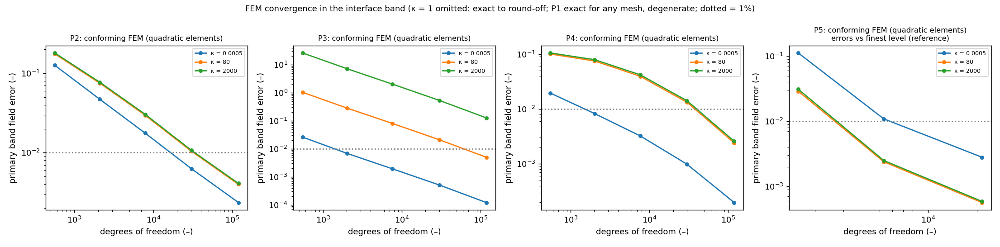

*Figure 1. Conforming quadratic FEM: primary band field error versus
degrees of freedom for P2–P5. κ = 1 is omitted (exact to round-off); P5
errors are relative to the finest level; dotted line = 1%.*

## 7. Results in 1D (P1)

Figure 2 shows the P1 failure map. Single-network F1 fails at every κ ≥
5, the interface-aware formulations F3–F5 fail from κ = 20, and the
soft-coupled formulations F2 and F6 survive to κ = 400 and κ = 2000
respectively.

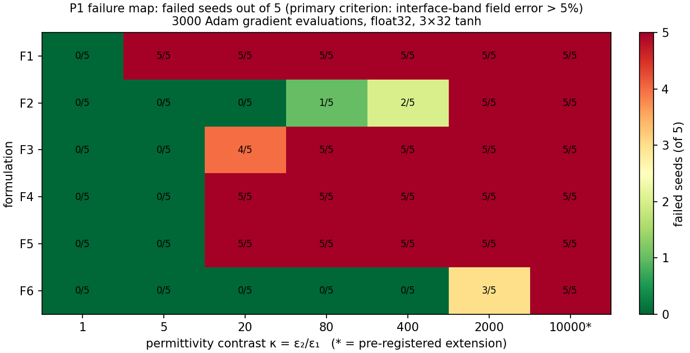

*Figure 2. P1 failure map: failed seeds (of 5) by formulation and
contrast; 10⁴ is the pre-registered extension.*

Over the 25 runs per formulation with κ ∈ {5, 20, 80, 400, 2000}, the
failure counts are F1 25, F2 8, F3 19, F4 20, F5 20 and F6 3. The
critical contrast, the smallest κ at which at least three of five seeds
fail, is 5 for F1, 20 for F3–F5 and 2000 for F2 and F6. At the
pre-registered extension κ = 10⁴, F2 and F6 fail in all five seeds.

H1 is supported. F1 fails in all seeds at every κ ≥ 5 because it
converges to the uniform-permittivity solution, for which its loss is
exactly zero, and F2's error grows monotonically with log κ (Spearman ρ
= 0.96, 95% CI 0.90–0.98). H3 is refuted: failing F2 and F6 runs violate
potential continuity (median jump 5.3% of the applied voltage) while the
flux jump is small (median 2.6 × 10⁻⁴), and none of the eleven failing
runs is flux-dominated. H4 is refuted by its pre-registered criterion:
supervised fitting of φ with the F2 architecture is not more accurate in
the field than PINN training where F2 fails.

The interface-aware designs fail earlier than the plain soft-coupled
ones. Pilot runs showed F3 and F5 succeeding with 20,000 steps, and
L-BFGS rescues F3 (Section 10), so at this budget building the interface
into the representation made optimisation harder rather than easier.
Seed variability is large: F2 at κ = 400 gives band errors of 0.212,
0.082, 0.005, 0.011 and 0.048 for seeds 0–4, and reporting only the best
seed would suggest 0.5% error where two of five runs fail.

## 8. Results in 2D (P2–P5)

In two dimensions the picture changes sharply. At κ ∈ {80, 2000} every
formulation fails all ten runs on P2, P3, P4 and P5, whereas on P1 the
same cells give 6/10 failures for F2 and 3/10 for F6 (Figure 3).

*Figure 3. Left: failed runs at κ ∈ {80, 2000} per problem and
formulation (5 seeds each). Right: median masking ratio R over κ ≠ 1
runs; dashed line = H2 threshold R = 3.*

### 8.1 Failure maps

Median band field errors at κ = 80 are listed in Table 4. Even the best
entries, F2 and F6 on the thin film at about 7%, exceed the failure
threshold.

**Table 4.** Median primary band field error at κ = 80 (5 seeds; 1 =
100%).

| Problem        | F1  | F2    | F3  | F4   | F5        | F6    |
|----------------|-----|-------|-----|------|-----------|-------|
| P2 cylinder    | 30  | 0.63  | 1.0 | 0.84 | 1.2       | 0.63  |
| P3 line charge | 31  | 6.1   | 3.5 | 8.5  | 1.3 × 10⁴ | 10.5  |
| P4 corner      | 14  | 0.69  | 1.0 | 17   | 1.7       | 0.70  |
| P5 thin film   | 30  | 0.070 | 1.6 | 2.4  | 2.8       | 0.069 |

Away from κ = 1, the only passing two-dimensional configurations are F2
and F6 on P5 at κ = 5 (0/5 failed) and κ = 20 (2/5 and 1/5 failed), and
F2 on P3 at mild inverse contrasts (0/5 failed at κ = 0.2 and 0.05). The
critical contrast of F2 and F6 thus drops from 2000 on P1 to 5 on P2–P4
and 80 on P5. H8 is refuted: Kendall's τ between the P1 and P2
formulation rankings by failure count is 0.30, below the pre-registered
0.6. On median error τ is 0.73, so the ordering of errors partly
transfers while the pass/fail picture does not.

### 8.2 Problem-specific findings

*Cylinder (P2).* F2 and F6 plateau at a band error of about 0.63. A
float64 run of 20,000 steps at κ = 5 stays at 0.486 from step 4,000 to
step 20,000, with per-term gradients of order 0.1 that cancel.
Minimising the F2 loss over a three-parameter family that contains the
exact solution recovers it to six digits (loss ≈ 10⁻³¹), so the loss is
correct and the plateau is a property of network training.

*Fixed-point quadrature overfitting (F5).* F5 fails even at κ = 1 on P2
and P4. On P2 its Monte Carlo energy (8) on the fixed points (0.59–1.59)
falls below the true minimum energy (2.0), while the true energy of its
prediction is 4.2–75: the network fits the quadrature points rather than
the field.

*Line charge (P3).* Subtracting the singular part separately in each
material, a pre-registered sensitivity analysis, lowers F2's error at κ
= 80 from 6.1 to 0.61, but all five seeds still fail.

*Corner (P4).* H10 is refuted. F2 underestimates the near-corner field
on both bisectors (median signed \|E\| error −0.58 to −0.88), but F1
overestimates it in the high-permittivity wedge (+5.7 at κ = 80, +18.6
at κ = 2000). The sign of the error depends on formulation and material.

*Thin film (P5).* The band error of F2 at κ = 80 falls for thinner films
(13% at t = 0.1, 7.0% at t = 0.02, 3.4% at t = 0.005), but the error
inside the film stays at 13–16% for every thickness; the pooled band
metric is dominated by the easier exterior field. Increasing the number
of film collocation points (128, 512, 2,048) has no measurable effect
(0.069, 0.070, 0.069). F3 and F5 fail even at κ = 1, plausibly because
the frozen level-set feature reaches magnitudes of about 150 away from
the film and saturates their tanh inputs; this was not tested further.

### 8.3 Masking: global potential error versus band field error (H2)

The ratio R = band field error / global potential error (κ ≠ 1 runs) has
medians 2.39 (P1), 7.5 (P2), 3.95 (P3), 4.0 (P4) and 8.2 (P5); R \> 1 in
97–100% of runs. Failures with global potential error below 5%
("concealed") are 23%, 1.7%, 2.4%, 11.7% and 37% of failures
respectively. H2's threshold R \> 3 is not met on P1 (CI 1.73–3.18), so
H2 is inconclusive as stated; it is met on every 2D problem.

## 9. Failure mechanisms

Four failure mechanisms are directly measured.

*Loss invisibility.* F1's loss is exactly zero at a wrong solution
\[15\]. Rescaling its residuals cannot help: under Intervention B, F1
converges to the uniform-permittivity solution at every κ with the
identical loss value 2.147 × 10⁻⁶ (Section 10).

*Continuity rather than flux.* Soft-coupled F2 and F6 fail with an
unsatisfied potential-continuity condition, both on P1 and on P2
(Sections 7 and 8.2).

*Early gradient imbalance, confounded with contrast (H11).* The median
over steps 0–300 of the log₁₀ ratio of the largest to the smallest
weighted per-term gradient norm predicts failure with AUC 0.85 (95% CI
0.77–0.92). It is, however, strongly correlated with log κ (ρ = 0.81),
and within a single κ the AUC ranges from 0.42 to 0.88, so its
predictive value is largely that of contrast itself (Appendix E).

*Fixed-point quadrature overfitting.* The Ritz formulation minimises a
Monte Carlo estimate (8) that can be driven below the true minimum
energy on a fixed point set (Sections 8.2, 10 and Appendix F).

We offer the following interpretation, which these experiments do not
demonstrate. At high contrast the unit-weight flux penalty in (6), whose
scale grows as D², dominates the continuity penalty; the optimiser
satisfies flux balance first and is left at a stationary point with a
potential jump. F6's physical rescaling (7) is consistent with its lower
one-dimensional failure count. On curved, singular and thin geometries
the same stationary point is reached at much lower contrast, and on P2
neither a stronger optimiser nor a longer budget escapes it (Section
12).

## 10. Controlled interventions (P1; H4, H5)

Five interventions were applied on P1, each changing one factor relative
to the baseline, using seeds 0–9 paired with the unchanged baseline seed
by seed, and judged by criteria logged before its runs (1,155 rows, of
which 270 were superseded after a defect fix; see C below). Only the
optimiser change (E) substantially reduced one-dimensional failures;
rebalancing (A) was mixed, residual normalisation (B) and hard
continuity (D) did not help, and the apparent precision effect (C)
proved to be an initialisation artefact (Table 5, Figure 4).

**Table 5.** Interventions on P1: predictions and pre-registered
verdicts.

| Intervention                                                          | Prediction                                         | Verdict                  | Key numbers                                                                                                                                                  |
|-----------------------------------------------------------------------|----------------------------------------------------|--------------------------|--------------------------------------------------------------------------------------------------------------------------------------------------------------|
| A: gradient-norm rebalancing \[25\] (L2-norm variant, every 10 steps) | Lowers error for F2 and F3                         | Mixed: 3/12 supported    | Helps F3 at κ ≥ 80 (κ = 400 median 1.06 → 0.033); harms F2 at every κ (10/10 fail at κ = 1 and 5). F3 at κ = 80 does not survive Holm correction (p = 0.107) |
| B: residual normalisation r_i/ε_i                                     | Helps F2 at κ ≥ 80                                 | Refuted (3/3)            | 1–2 of 10 seeds improve; F1 "no change" holds (identical flags 10/10)                                                                                        |
| C: float64                                                            | No material effect under Adam; larger under L-BFGS | Holds                    | Adam: median fold change 1.0001 (max 1.07), no flag changes; L-BFGS: float64 better in 6/6 cells (median fold 3.4)                                           |
| D: hard interface conditions                                          | F4 fails less than F2 at κ ≥ 400; F4full \< 1%     | F4 refuted; F4full holds | F4 fails 10/10 from κ = 20; F4full median 1.2 × 10⁻⁶ to 9.9 × 10⁻⁴ (trivial on P1: the exact solution lies in its buffer space)                              |
| E: L-BFGS; Adam 2k → L-BFGS 1k (equal evaluations)                    | Lower error for F3 and F5                          | Mixed: 9/12 supported    | F3 κ = 80: 0.55 → 3.5 × 10⁻⁵; F5 refuted at κ = 1 (quadrature overfitting); F2 (descriptive) κ = 2000 failures 9/10 → 4/10                                   |

**H4's intervention clause is not met:** A and B leave F2 at 9/10
failures at κ = 2000.

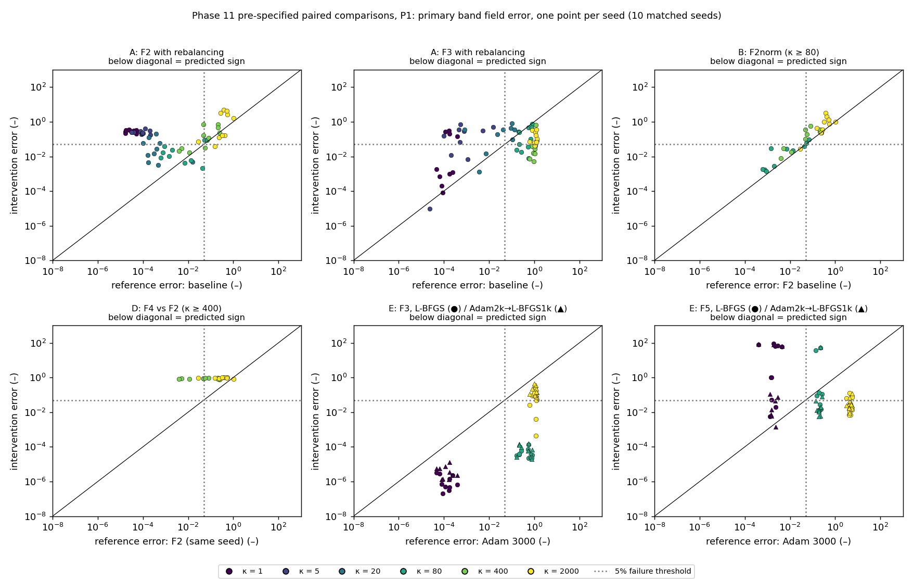

*Figure 4. Pre-specified paired comparisons, one point per seed (10
matched seeds); colour = κ; points below the diagonal follow the
predicted sign; dotted lines = 5% threshold.*

**Rebalancing inverts its intent near convergence.** The pre-registered
L²-norm variant of gradient rebalancing \[25\] updates the weight of
each non-PDE term every ten steps as

$$
\lambda_i\leftarrow 0.9\,\lambda_i+0.1\,\frac{\lVert\nabla_\theta\mathcal{L}_{\mathrm{pde}}\rVert_2}{\lVert\nabla_\theta\mathcal{L}_i\rVert_2} \tag{10}
$$

Terms that are already satisfied have small gradients and therefore
receive large weights (up to 5 × 10⁴), while the still-violated
continuity term, which has the largest gradient, is pushed down to 0.05.
The behaviour was confirmed with an independent implementation
(agreement to 6 × 10⁻⁸). It applies to the variant tested, not to every
rebalancing scheme.

**Initialisation variability exceeds the precision effect.** We first
measured precision effects up to 20.7× in median error; investigation
showed the float64 runs had drawn *different initial weights* from the
float32 runs with the same seed. With identical initialisation the
effect vanishes (fold change ≤ 1.07). On this problem, initialisation
alone exceeds the genuine precision effect under Adam by more than an
order of magnitude, which supports seed-level reporting and cautions
precision studies that do not control initial weights \[28\].

## 11. Robustness (P1; H6)

To test whether the conclusions depend on particular settings, the P1
study was repeated with one setting changed at a time: width 16 and 64,
depth 2 and 5, 32 and 512 collocation points per material, an initial
learning rate of 3 × 10⁻³, and 12,000 training steps. Each variation
covers all six formulations at κ ∈ {1, 80, 2000} with five seeds (720
runs). Two descriptive extras were added: a parameter-matched
two-network variant of width 22, and 16 additional collocation points
per side inside the interface band. The formulation ranking is robust in
all eight variations (Kendall τ-b ≥ 0.65), but the masking threshold R
\> 3 is met in only one of eight, so H6 is inconclusive by its criteria
(Figure 5).

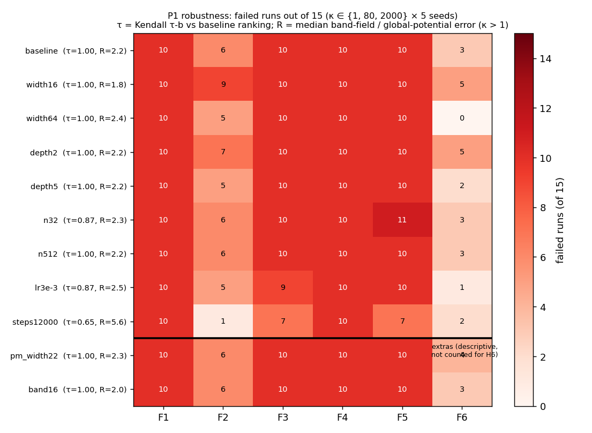

*Figure 5. Robustness on P1: failed runs (of 15: κ ∈ {1, 80, 2000} × 5
seeds) per formulation and setting, with Kendall τ-b against the
baseline ranking and median R. Rows below the line are descriptive
extras.*

The ranking correlation is τ = 1 in five of the eight variations and
lowest (0.65) for 12,000 steps. The masking ratio is stable at 1.84–2.49
in seven variations, against 2.24 for the baseline on the same subset:
the effect persists and it is the absolute threshold that fails. R also
decreases with contrast, from 3.4 at κ = 5–20 to 2.1 at κ = 2000.

Longer training (12,000 steps) reduces F2 failures from 6 to 1 out of 15
but doubles the number of concealed failures (7 → 16) and raises R to
5.6; with more training the global potential error becomes a worse
indicator of band field accuracy. Network capacity affects only F2 and
F6. Parameter matching does not remove their advantage: at width 22,
with fewer parameters than F1, they record 6 and 4 failures against 10
for every single-network formulation.

## 12. Comparison with finite elements (P2, P5; H7)

We compared the baseline PINNs, and the two remedies that changed
outcomes on P1, with interface-conforming quadratic FEM on P2 and P5.
The remedies were L-BFGS at equal budget for F2, F3 and F6 at κ ∈ {1,
80, 2000} (90 runs) and Adam for 20,000 steps for F2 and F6 at κ = 80
(20 runs). FEM cost is mesh generation, assembly and a sparse direct
solve. PINN time-to-target is the time of the first logged evaluation
(every 250 steps) that meets the target, scaled from the run's
wall-clock assuming constant cost per step; compile time is excluded.
Two comparisons are reported (Figure 6): the time needed to reach 5% and
1% band field error, and the error of the FEM mesh whose cost is closest
to the PINN's median wall-clock.

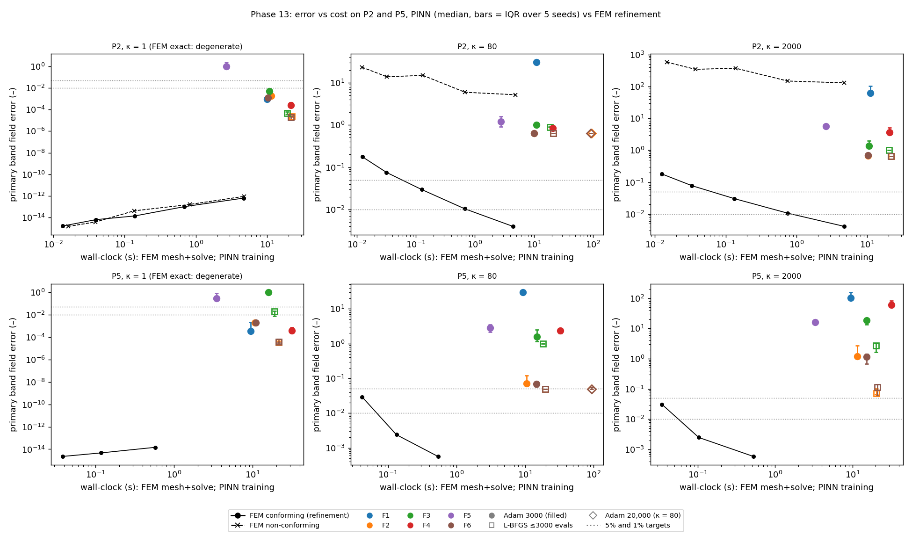

*Figure 6. Error versus wall-clock on P2 and P5: PINN medians (bars =
IQR over 5 seeds; colour = formulation, marker = optimiser/budget)
against conforming and non-conforming FEM refinement; dotted lines = 5%
and 1%.*

No PINN configuration reaches 1% band field error at any κ ≠ 1, in any
of 64 configurations or any seed, including both remedies. Conforming
FEM reaches 1% in 0.65–4.75 s on P2 and 0.10–0.58 s on P5. The 5% target
is reached only by F2 and F6 on P5 at κ = 80, in about 5 s with L-BFGS
and about 47 s with 20,000-step Adam, against 0.042 s for FEM, factors
of roughly 115 and 1,100. At equal cost, the FEM error is 86 to 1.7 ×
10⁵ times lower than the PINN median error (κ ≠ 1).

The remedies behave differently on the two problems. On P2 neither
L-BFGS nor 20,000 steps moves F2 or F6 from their plateau (0.634, 0.635
and 0.635 at κ = 80), in contrast with P1, where L-BFGS rescued F3 and
halved F2's failures at κ = 2000. On P5, L-BFGS brings F2 and F6 just
below 5% at κ = 80 and lowers their κ = 2000 errors (F2: 1.21 → 0.072),
which nevertheless still fail.

**H7: supported, excluding κ = 1.** At κ = 1 FEM is exact at every mesh;
there, 10 PINN configurations reach 1% within the first 250-step logging
interval, so the 10× margin cannot be resolved at this logging
resolution (logged ratios 21–139×).

**Caveats.** Timings are single-threaded CPU; P2 and P5 FEM ran on
different CPU models; GPU training would change absolute PINN times but
not which configurations reach 1%. κ = 5 and 20, where PINNs pass on P5,
have no FEM refinement records, so the PINN's most favourable regime is
absent from the time-to-target comparison.

## 13. Limitations

All conclusions are conditional on the stated budget, small tanh
networks, five seeds per configuration and the five problems tested.

*Budget and architecture.* The main budget is 3,000 gradient evaluations
(12,000 and 20,000 in specific checks), the networks are small tanh
MLPs, and training is in float32 except where stated. Larger networks,
adaptive sampling, curricula over contrast and other interface
architectures \[2, 4, 19\] were not tested at scale.

*Statistical resolution.* Five seeds per configuration give coarse
failure rates; 0/5 failures has a 95% upper bound of 52%.

*Reduced grid.* F3–F5 were run at κ ∈ {1, 80, 2000} only in two
dimensions, so their two-dimensional critical contrasts are resolved
only to that grid.

*Pre-registration gaps.* Several gaps were filled during the study,
including the configuration sets for H5, the ten-seed failure threshold
and the L-BFGS budget rule; all were logged before the affected runs.
One analysis addition, the logging-resolution check for H7, was made
after a trial analysis but before the verdict, and is stricter than the
original rule.

*Defects.* Six code defects were found and fixed during the study, each
with a regression test and with the original rows kept and labelled as
superseded (Appendix F). Two of them changed reported results before
correction: float64 runs initialised differently from float32 runs (270
runs rerun) and a biased F5 energy quadrature with non-uniform points
(15 runs rerun).

*Benchmark design.* The P5 level-set scaling probably disadvantages F3
and F5; the success of F4full on P1 is trivial because the exact
solution lies in its representation; interventions were run on P1 only
and remedies on P2 and P5 only.

*Bibliography.* The author lists of references \[1\] and \[29\] could
not be verified.

## 14. Discussion

Within the tested budget, PINN accuracy at dielectric interfaces is
governed less by contrast alone than by geometry.

A planar 1D interface tolerates κ up to 400–2000 for soft-coupled
two-network formulations; curved, singular and corner geometries fail
from κ = 5, and the thin film from κ = 80. The dominant failure is a
stationary point with unsatisfied potential continuity. More training, a
better optimiser or higher precision escapes it in 1D but not on the
curved interface.

Global potential error hides much of this: up to 37% of failures look
accurate by that measure. Studies of PINNs for dielectric problems
should therefore report interface-band field error with a stated
threshold, and seed-level failure rates rather than best runs.

Several plausible remedies failed under matched seeds (rebalancing,
residual normalisation, hard continuity), and the one apparent precision
effect was an initialisation artefact. This argues for controlled,
one-factor-at-a-time evaluation before attributing improvements to a
method.

The study does not show that PINNs cannot solve these problems:
interface-specialised architectures and larger budgets may succeed, and
published work reports such successes, usually as best-of-several runs.
Nor does it show that FEM is always preferable: P3 near a singular
source is hard for conforming FEM too, and PINNs offer mesh-free inverse
and parametric uses we did not evaluate. It shows that for these forward
problems, on this hardware, with these formulations and budget,
interface-conforming FEM reached 1% band field accuracy in seconds where
no PINN configuration reached it at all.

## 15. Conclusion

Across six PINN formulations and five dielectric-interface problems, 1D
success transfers poorly to 2D, global potential error systematically
understates interface field error, no single tested intervention removes
high-contrast failure on curved interfaces, and interface-conforming FEM
dominates on accuracy per unit cost for the forward problems tested.

These conclusions rest on pre-registered hypotheses, seed-level
statistics, interface-band field metrics, matched-seed interventions,
robustness variations and an FEM cost comparison, all regenerable from
the released raw data.

### Data and code availability

The project repository,
https://github.com/upcomingresearcher-cloud/PINNs-dielectric-, contains
the source code, the raw databases (3,856 completed runs plus 60
technical-failure rows, superseded rows retained and labelled),
processed outputs and figures, the frozen protocol and change log, and a
single analysis pipeline (scripts/make_all.py) that regenerates every
table and figure in about 70 s. Installation, testing (169 automated
tests) and reruns are described in docs/REPRODUCTION_GUIDE.md.

### Acknowledgments

The authors thank John DeMason (University of Michigan, Ann Arbor) for
his support. This work received no specific funding; all computations
were run on a single CPU core.

### Author contributions

Devesh Patwari, Daksh Mehta, Tolga Uras Kurtay and Yasir Balat conceived
and directed the study, reviewed the results and approved the final
manuscript. The AI system Claude (Anthropic) was used extensively under
the authors' direction: it wrote the code, ran the experiments,
performed the analyses and drafted the manuscript. The authors take full
responsibility for the content of this article.

### Competing interests

The authors declare no competing interests.

## References

1.  arXiv:2607.27349 (2026). Physics-informed neural networks for 2D
    plane wave scattering in arbitrary dielectric structures. *arXiv
    preprint*. Author list not verified.

2.  Chung, S. W., Castonguay, S. T., Roy, S., Penwarden, M. S., Fu, Y.,
    Roy, P. (2026). Hard-constrained physics-informed neural networks
    for interface problems. *arXiv:2604.08453*.

3.  E, W., Yu, B. (2018). The Deep Ritz method: a deep learning-based
    numerical algorithm for solving variational problems.
    *Communications in Mathematics and Statistics*, 6, 1–12.

4.  Fan, H., Tan, Z. (2025). Novel and general discontinuity-removing
    PINNs for elliptic interface problems. *Journal of Computational
    Physics*, 529, 113861.

5.  Grossmann, T. G., Komorowska, U. J., Latz, J., Schönlieb, C.-B.
    (2024). Can physics-informed neural networks beat the finite element
    method? *IMA Journal of Applied Mathematics*.
    doi:10.1093/imamat/hxae011

6.  Guo, H., Yang, X. (2021). Deep unfitted Nitsche method for elliptic
    interface problems. *arXiv:2107.05325*.

7.  Hao, Z., Yao, J., Su, C., Su, H., Wang, Z., Lu, F., Xia, Z., Zhang,
    Y., Liu, S., Lu, L., Zhu, J. (2023). PINNacle: a comprehensive
    benchmark of physics-informed neural networks for solving PDEs.
    *arXiv:2306.08827*.

8.  He, C., Hu, X., Mu, L. (2020). A mesh-free method using piecewise
    deep neural network for elliptic interface problems.
    *arXiv:2005.04847*.

9.  Hu, W.-F., Lin, T.-S., Lai, M.-C. (2022). A discontinuity capturing
    shallow neural network for elliptic interface problems. *Journal of
    Computational Physics*, 469, 111576.

10. Huang, Y. (2021). Parallel physics-informed neural networks with
    bidirectional balance. *arXiv:2111.05641*.

11. Jagtap, A. D., Karniadakis, G. E. (2020). Extended physics-informed
    neural networks (XPINNs): a generalized space-time domain
    decomposition based deep learning framework for nonlinear partial
    differential equations. *Communications in Computational Physics*,
    28(5).

12. Jagtap, A. D., Kharazmi, E., Karniadakis, G. E. (2020). Conservative
    physics-informed neural networks on discrete domains for
    conservation laws. *Computer Methods in Applied Mechanics and
    Engineering*, 365, 113028.

13. Krishnapriyan, A. S., Gholami, A., Zhe, S., Kirby, R. M.,
    Mahoney, M. W. (2021). Characterizing possible failure modes in
    physics-informed neural networks. *Advances in Neural Information
    Processing Systems*, 34.

14. Moseley, B., Markham, A., Nissen-Meyer, T. (2023). Finite basis
    physics-informed neural networks (FBPINNs). *Advances in
    Computational Mathematics*, 49(4), 62.

15. Nohra, M., Dufour, S. (2024). Physics-informed neural networks for
    the numerical modeling of steady-state and transient electromagnetic
    problems with discontinuous media. *arXiv:2406.04380*.

16. Qin, F., Wang, Z., Ma, Z., Li, Z. (2017). Accurate gradient
    computations at interfaces using finite element methods.
    *International Journal of Applied Mathematics and Computer Science*,
    27(3), 527–537. doi:10.1515/amcs-2017-0037

17. Rahaman, N., Baratin, A., Arpit, D., Draxler, F., Lin, M.,
    Hamprecht, F., Bengio, Y., Courville, A. (2019). On the spectral
    bias of neural networks. *International Conference on Machine
    Learning*, 5301–5310.

18. Raissi, M., Perdikaris, P., Karniadakis, G. E. (2019).
    Physics-informed neural networks. *Journal of Computational
    Physics*, 378, 686–707.

19. Roy, S., Annavarapu, C., Roy, P., Sarma, A. K. (2024). Adaptive
    interface-PINNs (AdaI-PINNs). *arXiv:2406.04626*.

20. Sarma, A. K., Roy, S., Annavarapu, C., Roy, P., Jagannathan, S.
    (2024). Interface PINNs (I-PINNs). *Computer Methods in Applied
    Mechanics and Engineering*, 429, 117135.

21. Sukumar, N., Srivastava, A. (2022). Exact imposition of boundary
    conditions with distance functions in physics-informed deep neural
    networks. *Computer Methods in Applied Mechanics and Engineering*,
    389, 114333.

22. Sun, Q., Xu, X., Yi, H. (2025). Dirichlet–Neumann learning algorithm
    for solving elliptic interface problems. *Communications in
    Computational Physics*, 38(1), 248–284.
    doi:10.4208/cicp.OA-2024-0046

23. Tarekegn, M., Wu, C., Sharma, T., Garg, S. (2026). Optimizer or
    precision? Understanding optimizer-precision interactions in PINNs.
    *NeurIPS (poster)*.

24. Tseng, Y.-H., Lin, T.-S., Hu, W.-F., Lai, M.-C. (2023). A
    cusp-capturing PINN for elliptic interface problems. *Journal of
    Computational Physics*, 491, 112359.

25. Wang, S., Teng, Y., Perdikaris, P. (2021). Understanding and
    mitigating gradient flow pathologies in physics-informed neural
    networks. *SIAM Journal on Scientific Computing*, 43(5),
    A3055–A3081.

26. Wu, S., Lu, B. (2022). INN: interfaced neural networks as an
    accessible meshless approach for solving interface PDE problems.
    *Journal of Computational Physics*, 470, 111588.

27. Wu, S., Zhu, A., Tang, Y., Lu, B. (2023). Convergence of
    physics-informed neural networks applied to linear second-order
    elliptic interface problems. *Communications in Computational
    Physics*, 33(2), 596–627. doi:10.4208/cicp.OA-2022-0218

28. Xu, C., Liu, D., Nassereldine, A., Xiong, J. (2025). FP64 is all you
    need: rethinking failure modes in physics-informed neural networks.
    *NeurIPS (poster)*; arXiv:2505.10949.

29. Zhang et al. (2023). Physics informed neural networks for electric
    field distribution characteristics analysis. *Journal of Physics D:
    Applied Physics*, 56, 165202. Author list not verified.

30. Zhang, B., Wu, G., Gu, Y., Wang, X., Wang, F. (2022). Multi-domain
    physics-informed neural network for steady-state heat conduction in
    multilayer media. *Physics of Fluids*, 34(11).

## Appendix A. Nomenclature

**Table A1.** Symbols and abbreviations.

| Symbol    | Meaning                                                               |
|-----------|-----------------------------------------------------------------------|
| φ         | Electric potential                                                    |
| E = −∇φ   | Electric field                                                        |
| D = εE    | Electric displacement                                                 |
| ε₁, ε₂    | Permittivities of materials 1 and 2 (ε₁ = 1)                          |
| κ = ε₂/ε₁ | Permittivity contrast; κ \< 1 is an inverse contrast                  |
| Γ, B      | Material interface; interface band (points within 0.05 of Γ)          |
| \[\[·\]\] | Jump across Γ                                                         |
| e_S(u)    | Relative L² error of u over region S, eq. (3)                         |
| e_prim    | Primary metric: max of band E and D errors, eq. (4)                   |
| R         | Masking ratio e_prim / e_Ω(φ), eq. (5)                                |
| D_s, ε_h  | Displacement scale and harmonic-mean permittivity used by F6, eq. (7) |
| J\[φ\]    | Monte Carlo Ritz energy used by F5, eq. (8)                           |
| λ_i       | Loss weight of term i under rebalancing, eq. (10)                     |
| τ, τ-b    | Kendall rank correlation (tie-corrected)                              |
| AUC       | Area under the ROC curve                                              |
| DOF       | Degrees of freedom of an FEM discretisation                           |
| FEM       | Finite element method                                                 |
| L-BFGS    | Limited-memory Broyden–Fletcher–Goldfarb–Shanno optimiser             |
| PINN      | Physics-informed neural network                                       |

## Appendix B. Pre-registered hypotheses and criteria

The criteria below are reproduced from the frozen experimental protocol
(version 1.0.0). Operational details added before the relevant runs,
such as H5's configuration sets, are listed in Appendix F.

**Table B1.** Hypotheses, experiments and decision criteria.

| H   | Relationship                                                                                         | Experiment                                              | Supported if                                                                                                                                                               | Refuted if                                                                                                |
|-----|------------------------------------------------------------------------------------------------------|---------------------------------------------------------|----------------------------------------------------------------------------------------------------------------------------------------------------------------------------|-----------------------------------------------------------------------------------------------------------|
| H1  | Contrast drives failure for F1 and unit-weight soft coupling (F2); interface-aware designs fail less | P1 primary sweep                                        | F1 fails ≥ 4/5 at every κ ≥ 5; Spearman ρ(log κ, error) for F2 \> 0 with CI excluding 0; each of F3–F6 has fewer failed seeds than F1 over κ \> 1                          | F1 passes ≥ 2/5 at any κ ≥ 20; or F2 ρ CI includes 0 or is negative; or any of F3–F6 fails as often as F1 |
| H2  | Global potential error understates band field error                                                  | All P1 runs with κ \> 1                                 | Median R \> 3; R \> 1 in ≥ 80% of runs; ≥ 20% of failures concealed (e_Ω(φ) \< 5%)                                                                                         | Median R ≤ 1                                                                                              |
| H3  | Soft-coupled failures violate flux, not potential, continuity                                        | F2, F6 runs                                             | ≥ 80% of failing runs have relative D jump \> 5% and relative φ jump \< 1%                                                                                                 | \< 50% show the flux-dominant pattern                                                                     |
| H4  | F1 failures are loss-visibility failures; high-κ F2 failures are optimisation failures               | Regression baseline; loss visibility; Interventions A/B | Regression \< 1% for every architecture and κ; L_F1(wrong) ≤ L_F1(exact); L(wrong)/L(exact) \> 10 for F2–F6; A or B removes ≥ 3 F2 failures where the baseline fails ≥ 4/5 | Regression \> 5% where F2 fails; or interventions change no F2 outcome                                    |
| H5  | Each intervention moves failure in a stated direction                                                | Interventions A–E, matched seeds                        | Predicted sign in ≥ 9/10 seeds                                                                                                                                             | Predicted sign in ≤ 5/10 seeds, or opposite sign in ≥ 9/10                                                |
| H6  | Rankings and masking are not artefacts of one setting                                                | Eight robustness variations                             | τ ≥ 0.6 in ≥ 6/8 variations and median R \> 3 in ≥ 6/8                                                                                                                     | τ \< 0.6 in ≥ 3/8                                                                                         |
| H7  | Conforming FEM reaches accuracy at much lower cost and is more accurate at equal time                | Remedy comparison on P2, P5                             | For every formulation, FEM time-to-1% ≥ 10× smaller than PINN median, or PINN never reaches 1%; FEM error at PINN median time lower                                        | Any PINN median time-to-target within 10× of FEM                                                          |
| H8  | P1 conclusions transfer to curved and singular geometries                                            | P2–P5                                                   | τ ≥ 0.6 between P1 and P2 rankings; median R \> 3 on each of P2–P5                                                                                                         | τ \< 0.6, or R ≤ 1 on any of P2–P5                                                                        |
| H9  | Evaluator reusable: new problems need only a problem module                                          | P2–P5 implementation                                    | No edits to evaluator core after the P1 freeze except additive metrics                                                                                                     | A core metric function must be rewritten                                                                  |
| H10 | Smooth networks underestimate the near-corner field                                                  | P4                                                      | Median signed field error at r = 0.02 and 0.05 (fixed rays, each material) below −10% for F1 and F2                                                                        | Within ±10%, or positive                                                                                  |
| H11 | Early gradient ratios predict failure                                                                | P1 runs of F2, F3, F4, F6                               | AUC ≥ 0.75 with CI lower bound \> 0.5 (median log ratio, steps 0–300)                                                                                                      | AUC CI includes 0.5                                                                                       |

## Appendix C. Training, sampling and evaluation settings

**Table C1.** Frozen settings (identical across formulations unless
stated).

| Setting                | 1D (P1)                                                       | 2D (P2–P5)                                                                                     |
|------------------------|---------------------------------------------------------------|------------------------------------------------------------------------------------------------|
| Network                | Fully connected, tanh, 3 hidden layers × 32                   | Same                                                                                           |
| Parameters per network | 2,209                                                         | Same architecture; inputs per formulation                                                      |
| Initialisation         | Glorot normal weights, zero biases; drawn in float32 and cast | Same                                                                                           |
| Optimiser              | Adam (β₁ = 0.9, β₂ = 0.999, ε = 10⁻⁸)                         | Same                                                                                           |
| Learning rate          | Cosine decay 10⁻³ → 10⁻⁴ over the budget                      | Same                                                                                           |
| Budget                 | 3,000 value-and-gradient evaluations                          | Same                                                                                           |
| Precision              | float32                                                       | float32                                                                                        |
| Collocation            | Stratified jitter, 128 points per material                    | 512 interior per material, 128 interface, 64 per box edge                                      |
| Seeds                  | 0–4 (0–9 for interventions)                                   | 0–4                                                                                            |
| Gradient logging       | Per-term loss and gradient norms every 25 steps               | Same                                                                                           |
| Metric logging         | All evaluator metrics every 250 steps                         | Same                                                                                           |
| Interface band         | Distance ≤ 0.05 from Γ                                        | Same (P5: includes film)                                                                       |
| Failure threshold      | e_prim \> 0.05                                                | Same                                                                                           |
| Contrasts              | {1, 5, 20, 80, 400, 2000} + extension 10⁴                     | F1, F2, F6: {0.0005, 0.0025, 0.0125, 0.05, 0.2, 1, 5, 20, 80, 400, 2000}; F3–F5: {1, 80, 2000} |
| Hardware               | Single CPU core, Intel Xeon (2.10 and 2.80 GHz)               | Same                                                                                           |
| Software               | Python 3.12, JAX 0.11.2, Optax 0.2.8                          | Plus scikit-fem 12.0.2, gmsh 4.15.2                                                            |

**Intervention and remedy settings.** L-BFGS uses memory 50 and a zoom
line search with at most 20 steps; an iteration starts only if its worst
case fits in the remaining budget. The hybrid variant runs Adam for
2,000 steps with its own full cosine schedule, then L-BFGS for at most
1,000 evaluations. Rebalancing (A) updates λ every 10 steps by (10).
Residual normalisation (B) divides the PDE residual of material i by
ε_i; interface residuals are unchanged.

## Appendix D. Complete two-dimensional failure maps

Figures D1–D4 give the failed-seed counts (of 5) for every formulation
and contrast on each two-dimensional problem. Cells marked "not run"
follow the pre-registered reduced grid for F3–F5; κ \< 1 denotes inverse
contrast.

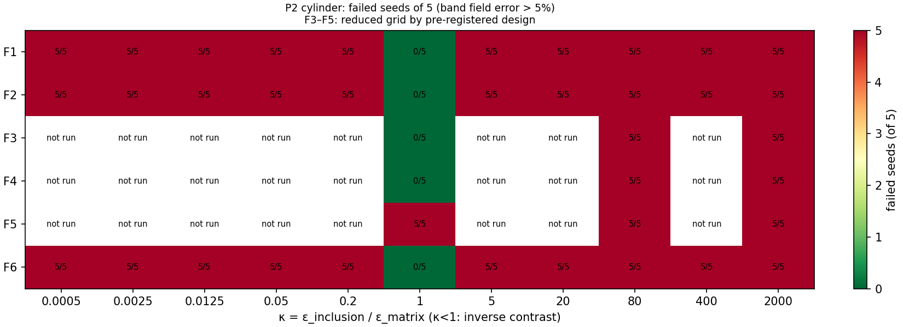

*Figure D1. P2, dielectric cylinder: failed seeds of 5 (primary
criterion).*

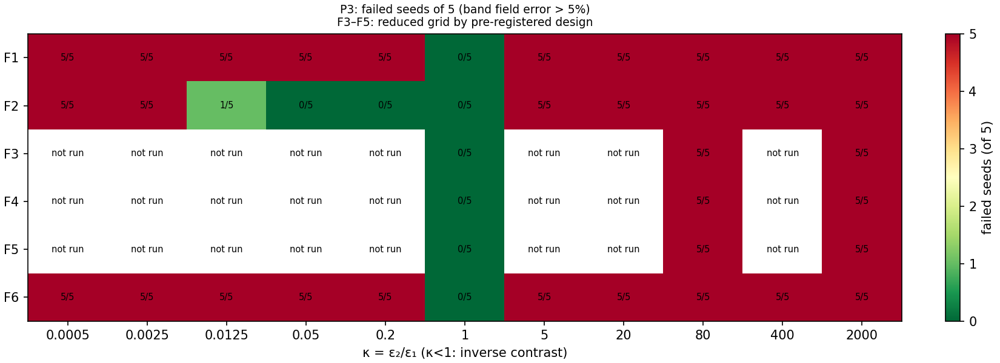

*Figure D2. P3, line charge above a planar interface: failed seeds of
5.*

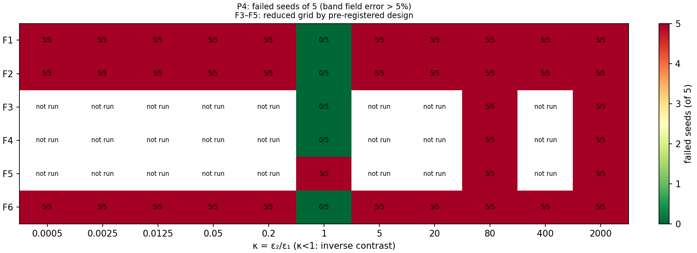

*Figure D3. P4, two-material corner: failed seeds of 5.*

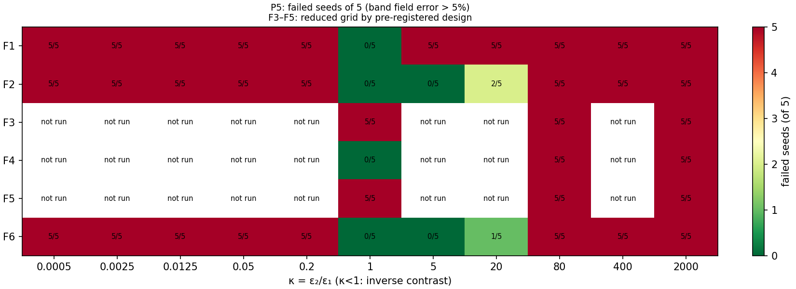

*Figure D4. P5, thin high-permittivity film: failed seeds of 5.*

## Appendix E. Intervention, robustness and training-dynamics details

**Table E1.** Intervention and remedy run sets.

| Set                                  | Formulations            | Contrasts       | Seeds | Runs                |
|--------------------------------------|-------------------------|-----------------|-------|---------------------|
| Baseline extension (seeds 5–9)       | F1–F4 (all κ), F5 (3 κ) | P1 primary grid | 5–9   | 135                 |
| A: rebalancing                       | F2, F3                  | 6 primary κ     | 0–9   | 120                 |
| B: residual normalisation            | F1, F2                  | 6 primary κ     | 0–9   | 120                 |
| C: float64 replica (Adam)            | F1–F6                   | 6 primary κ     | 0–4   | 180                 |
| C: float64 2 × 2 cells               | F2, F3                  | 1, 80, 2000     | 0–9   | 30 Adam + 60 L-BFGS |
| D: F4full                            | F4full                  | 6 primary κ     | 0–9   | 60                  |
| E: L-BFGS; Adam 2k → L-BFGS 1k       | F2, F3, F5              | 1, 80, 2000     | 0–9   | 90 + 90             |
| Remedies (P2, P5): L-BFGS            | F2, F3, F6              | 1, 80, 2000     | 0–4   | 90                  |
| Remedies (P2, P5): Adam 20,000 steps | F2, F6                  | 80              | 0–4   | 20                  |

The 270 float64 runs originally recorded under C were superseded after
the initialisation defect was fixed (Appendix F); with matched
initialisation the median fold change of the primary error under Adam is
1.0001 (maximum 1.07, no failure-flag changes), against 1.38 (maximum
20.7) for the superseded runs.

**Table E2.** Robustness on P1: failed runs of 15 (κ ∈ {1, 80, 2000} × 5
seeds), Kendall τ-b against the baseline ranking, and median masking
ratio R (κ \> 1).

| Setting                     | F1  | F2  | F3  | F4  | F5  | F6  | τ-b  | R    |
|-----------------------------|-----|-----|-----|-----|-----|-----|------|------|
| Baseline                    | 10  | 6   | 10  | 10  | 10  | 3   | 1    | 2.24 |
| Width 16                    | 10  | 9   | 10  | 10  | 10  | 5   | 1.00 | 1.84 |
| Width 64                    | 10  | 5   | 10  | 10  | 10  | 0   | 1.00 | 2.37 |
| Depth 2                     | 10  | 7   | 10  | 10  | 10  | 5   | 1.00 | 2.18 |
| Depth 5                     | 10  | 5   | 10  | 10  | 10  | 2   | 1.00 | 2.25 |
| 32 points/material          | 10  | 6   | 10  | 10  | 11  | 3   | 0.87 | 2.28 |
| 512 points/material         | 10  | 6   | 10  | 10  | 10  | 3   | 1.00 | 2.24 |
| Learning rate 3 × 10⁻³      | 10  | 5   | 9   | 10  | 10  | 1   | 0.87 | 2.49 |
| 12,000 steps                | 10  | 1   | 7   | 10  | 7   | 2   | 0.65 | 5.62 |
| Width 22 (extra)            | 10  | 6   | 10  | 10  | 10  | 4   | 1.00 | 2.28 |
| 16 band points/side (extra) | 10  | 6   | 10  | 10  | 10  | 3   | 1.00 | 2.02 |

Figure E1 shows training convergence of the primary error for
representative formulations and problems, and Figure E2 the relation
between early gradient imbalance and final error underlying H11.

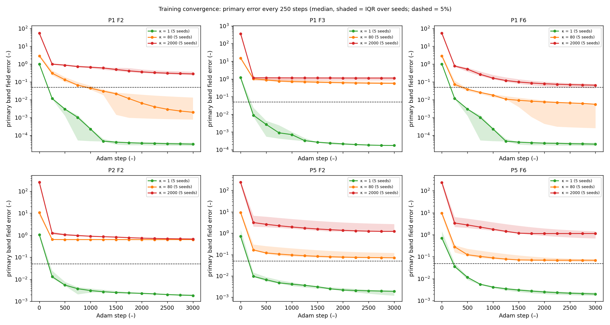

*Figure E1. Primary band field error every 250 Adam steps (median,
shaded = IQR over 5 seeds) for P1 F2, F3, F6 and P2, P5 F2, F6 at κ = 1,
80 and 2000; dashed line = 5%.*

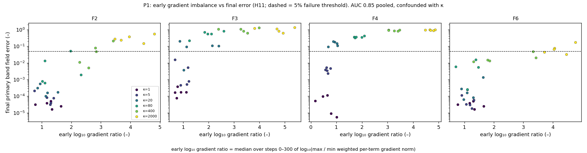

*Figure E2. Median early (steps 0–300) log₁₀ ratio of largest to
smallest weighted per-term gradient norm versus final primary error, P1,
coloured by κ; dashed line = 5%.*

## Appendix F. Protocol change log and defect record

The protocol was frozen at version 1.0.0 and reached version 1.6.0 by
the end of the study. Every change records its date, reason, affected
experiments and required reruns. The principal operational decisions,
each logged before the runs it governs, are summarised in Table F1 and
the defects in Table F2.

**Table F1.** Principal post-freeze decisions.

| Item                        | Decision                                                                                         | Logged                                     |
|-----------------------------|--------------------------------------------------------------------------------------------------|--------------------------------------------|
| Robustness budget variation | 12,000-step variation added after the pilot                                                      | Before the primary sweep (v1.1.0)          |
| H5 configuration sets       | A: F2, F3 × 6 κ; B: F2 at κ ≥ 80; D: F4 vs F2 at κ ≥ 400; E: F3, F5 × {1, 80, 2000} × 2 variants | Before intervention runs                   |
| 10-seed failure threshold   | A configuration fails if ≥ 6/10 seeds fail (sensitivity ≥ 5/10)                                  | Before intervention runs                   |
| L-BFGS budget rule          | Count every function-and-gradient evaluation; start an iteration only if its worst case fits     | Before intervention runs                   |
| Residual normalisation (B)  | Applied to material PDE residuals only                                                           | Before intervention runs                   |
| Robustness reference and τ  | Baseline on the same subset; τ-b on failure counts; undefined τ counts as \< 0.6                 | Before robustness runs                     |
| Remedy selection (Phase 13) | L-BFGS and 20,000-step Adam; A and B not carried over (refuted on P1)                            | Before remedy runs                         |
| H7 resolution check         | Clause 1 also tested at the lower bound of each 250-step logging interval (stricter)             | After a trial analysis, before the verdict |

**Table F2.** Defects found, effect and remedy (each with a regression
test; superseded rows retained).

| Defect                                                            | Effect on results                                        | Remedy                                                   |
|-------------------------------------------------------------------|----------------------------------------------------------|----------------------------------------------------------|
| Gradient formula error in 2D FEM post-processing                  | None (caught by a reproduction test before use)          | Fixed                                                    |
| Shape error in ahead-of-time compiled 2D training (P3)            | 60 runs failed for a technical reason                    | Fixed; runs repeated; failed rows kept                   |
| Derivative error in P4 verification code                          | None (verification code only)                            | Fixed                                                    |
| float64 runs initialised with different weights from float32 runs | Precision effect overstated (up to 20.7×)                | Initialisation drawn in float32 and cast; 270 runs rerun |
| F5 energy estimate unweighted with non-uniform extra band points  | F5 failed at κ = 1 in a robustness extra                 | Importance weights 1/ρ; 15 runs rerun                    |
| Missing problem filter in a P2 summary script                     | Regenerated P2 tables would mix other problems' FEM rows | Filter added; outputs regenerated                        |

Unexpected results that were investigated and found not to be defects
include the low-contrast degradation under rebalancing (Section 10), F5
quadrature overfitting under L-BFGS at κ = 1, and the F1norm magnitudes
under Intervention B.

## Appendix G. Reproducibility and software

The project repository
(https://github.com/upcomingresearcher-cloud/PINNs-dielectric-) contains
the source code, raw run databases, processed tables, figures, the
frozen protocol, the change log and a reproduction guide. Every
completed run is one row of the database with its full configuration,
all metrics, cost, software environment, hardware and git commit;
per-run training trajectories (every 250 steps) and per-term gradient
logs (every 25 steps) are stored separately.

**Table G1.** Reproduction steps.

| Step                              | Command                                                                        | Time on one CPU core |
|-----------------------------------|--------------------------------------------------------------------------------|----------------------|
| Install pinned environment        | sh scripts/setup_environment.sh                                                | Minutes              |
| Rebuild P5 FEM references         | python scripts/rebuild_p5_references.py                                        | About 3 min          |
| Run all tests (169)               | python -m pytest tests                                                         | About 9 min          |
| Evaluator self-tests              | python scripts/run_evaluator_selftests.py; scripts/run_selftests_2d.py P2 … P5 | About 1 min          |
| Regenerate every table and figure | python scripts/make_all.py                                                     | About 70 s           |

Regression tests retrain stored primary configurations in one and two
dimensions and require agreement with the database to 10⁻¹³. Results are
deterministic on the same software stack and CPU type; different
hardware or library versions can change individual runs at round-off
level, which training dynamics can amplify, so medians and failure
counts are the quantities to compare. Software: Python 3.12, NumPy
2.4.4, SciPy 1.17.1, pandas 3.0.2, JAX 0.11.2, Optax 0.2.8, scikit-fem
12.0.2, gmsh 4.15.2, Matplotlib 3.10.8.
